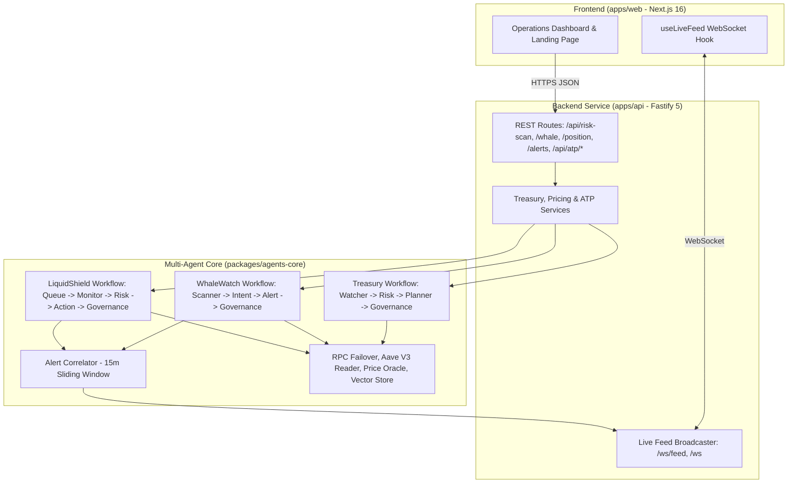

# CHAIN.SENTINEL

Autonomous multi-agent DeFi treasury intelligence, lending position monitoring, and risk-containment platform.

**Author & Maintainer:** Vismay  
**Repository:** [https://github.com/vismaygawai/chain.sentinel](https://github.com/vismaygawai/chain.sentinel)  
**License:** MIT

---

## 1. Overview

CHAIN.SENTINEL monitors EVM treasuries, Aave V3 lending positions, and large token transfers using a hybrid architecture that pairs deterministic financial risk models with `@iqai/adk` (ADK-TS) agent orchestration.

### Problem Statement

DeFi treasuries and leveraged lending positions face rapid market-driven liquidations, high single-asset concentration risk, and large whale-driven liquidity shifts. Manual monitoring and reactive notifications often arrive after collateral thresholds are breached.

### Objectives

- Evaluate on-chain treasury balances, single-asset concentration, and Aave V3 account health factors in real time.
- Monitor registered addresses for large ETH/ERC-20 transfers (`>= $500,000`) and correlate whale movements with lending health deterioration within a 15-minute sliding window.
- Enforce deterministic risk-policy guardrails (`CONSERVATIVE`, `BALANCED`, `AGGRESSIVE`) alongside LLM-assisted planning and governance arbitration.
- Stream correlated threat signals to an operations dashboard over WebSockets.

---

## 2. Key Features

- **Treasury Risk Scan (`watcherAgent`, `riskAgent`, `plannerAgent`, `governanceAgent`)**: Queries ETH, WETH, USDT, USDC, DAI, WBTC balances and Aave V3 `getUserAccountData`, computes deterministic risk scores (`0–100`) and tiers (`SAFE`, `WARNING`, `DANGER`, `CRITICAL`), generates mitigation plans (`ALERT`, `REDUCE`, `DIVERSIFY`), and enforces deterministic hard safety overrides on high-risk treasuries above `$1,000,000`.
- **LiquidShield Aave V3 Monitoring (`scanPositionWorkflow`, `monitorAgent`, `actionAgent`, `lsGovernanceAgent`)**: Prioritizes monitored positions in a risk-tiered queue (`CRITICAL` 12s, `DANGER` 30s, `WARNING` 2m, `SAFE` 10m), tracks health factor history, and calculates required debt repayments.
- **WhaleWatch Transfer Surveillance (`watchWalletWorkflow`, `scannerAgent`, `intentAgent`, `alertAgent`, `wwGovernanceAgent`)**: Polls Ethereum mainnet transfers via Alchemy `alchemy_getAssetTransfers`, deduplicates transaction hashes, classifies address intent using `knownAddresses.json` and vector similarity, and applies alert cooldown gates.
- **Cross-Agent Threat Correlator (`alertCorrelator`)**: Maintains a 15-minute sliding window correlating WhaleWatch transfers and LiquidShield position snapshots into escalated `CompoundAlert` events.
- **Agent Tokenization Platform (ATP) Integration**: Exposes agent metadata, status, and API-key-protected registration endpoints (`/api/atp/status`, `/api/atp/metadata`, `/api/atp/register`) plus a CLI registration script (`scripts/deploy-atp.ts`).
- **Operations Dashboard (`apps/web`)**: Next.js 16 + Tailwind CSS dashboard featuring address scanning, policy selection, asset allocation breakdown, governance action simulation, monitored entity cards, and a live WebSocket alert feed.

---

## 3. Technology Stack

| Layer | Technologies |
| :--- | :--- |
| **Monorepo & Runtime** | Node.js `>= 20.0.0` (CI targets `24.x`), `pnpm` `9.0.0`, TypeScript `5.9.3`, `tsx` |
| **Agent Core (`packages/agents-core`)** | `@iqai/adk` `0.8.1`, `ethers` `6.16.0`, `zod` `4.x`, `dotenv` |
| **Backend API (`apps/api`)** | `fastify` `5.12.x`, `@fastify/cors`, `@fastify/rate-limit`, `@fastify/websocket` |
| **Frontend (`apps/web`)** | Next.js `16.4.6` (App Router), React `18.3.1`, Tailwind CSS `3.4.x`, ESLint `9` |
| **Data & Feeds** | EVM JSON-RPC failover pool, Aave V3 Pool (`0x87870Bca3F3fD6335C3F4ce8392D69350B4fA4E2`), CoinGecko & DeFiLlama price APIs, Alchemy `alchemy_getAssetTransfers`, local JSON store & in-memory TTL cache |

---

## 4. System Architecture



---

## 5. Repository Structure

```text
chain.sentinel/
├── .github/workflows/
│   ├── ci.yaml                         # Monorepo typecheck, unit/API tests, and web build
│   └── lint.yaml                       # ESLint check for apps/web
├── apps/
│   ├── api/                            # Fastify REST API & WebSocket server
│   │   ├── local_db.json               # Local JSON persistence store for monitored addresses
│   │   └── src/
│   │       ├── __tests__/              # Fastify API integration & security tests
│   │       ├── config/                 # Environment, chain definitions, monitored tokens
│   │       ├── controllers/            # Request validation and controller handlers
│   │       ├── middlewares/            # Redacting centralized error handler
│   │       ├── routes/                 # /health*, /api/risk-scan, /whale, /position, /api/atp/*
│   │       ├── services/               # Treasury, pricing, and ATP metadata services
│   │       ├── types/                  # API request/response TypeScript interfaces
│   │       └── websocket/              # WebSocket live feed with replay buffer & heartbeat
│   └── web/                            # Next.js 16 operations dashboard
│       └── src/
│           ├── app/                    # App Router pages (/, /dashboard) & global styles
│           ├── components/             # RiskCard, ActionList, AllocationChart, AlertPanel, etc.
│           ├── hooks/                  # useRiskScan and useLiveFeed hooks
│           ├── lib/                    # API client & formatters
│           └── types/                  # Shared frontend TypeScript definitions
├── packages/
│   └── agents-core/                    # ADK-TS agents, workflows, policies, memory & tools
│       └── src/
│           ├── __tests__/              # Deterministic unit tests for core modules
│           ├── agents/                 # Watcher, Risk, Planner, Governance, Scanner, Intent, Alert, Monitor, Action
│           ├── correlation/            # 15-minute sliding-window compound alert correlator
│           ├── data/                   # Known exchange/entity address directory
│           ├── lib/                    # ADK agent factory & security helpers
│           ├── llm/                    # Local Qwen LLM adapter
│           ├── memory/                 # In-memory TTL cooldown/history & threat vector store
│           ├── policies/               # Conservative, Balanced, Aggressive, WW, and LS policies
│           ├── queues/                 # Risk-tiered LiquidShield scan priority queue
│           ├── schemas/                # Zod & JSON Schema definitions for risk signals
│           ├── tools/                  # Resilient RPC, Aave V3, CoinGecko/DeFiLlama prices, Alchemy tools
│           └── workflows/              # Treasury, WhaleWatch, and LiquidShield orchestration
├── docs/                               # Architecture, API, ATP deployment, and walkthrough docs
├── scripts/                            # build-all, clean, deploy-atp, seed-demo-data, export-codebase
├── .env.example                        # Safe environment variable template
├── package.json                        # Root workspace scripts and pnpm overrides
├── pnpm-workspace.yaml                 # Monorepo workspace definition
├── render.yaml                         # Render deployment blueprint for apps/api
└── tsconfig.base.json                  # Shared strict TypeScript base configuration
```

---

## 6. Prerequisites & Installation

### Prerequisites

- **Node.js**: `>= 20.0.0` (recommended `24.x`, see `.nvmrc`)
- **pnpm**: `9.0.0` (`npm install -g pnpm@9.0.0` or `npx pnpm@9.0.0`)

### Installation

```bash
git clone https://github.com/vismaygawai/chain.sentinel.git
cd chain.sentinel
pnpm install --frozen-lockfile
```

### Environment Setup

```bash
cp .env.example .env
```

Edit `.env` to provide your own API keys and endpoints as needed. Never commit `.env` files containing real credentials.

---

## 7. Environment Variables

| Variable | Component | Description | Default / Example |
| :--- | :--- | :--- | :--- |
| `GEMINI_API_KEY` | `agents-core` | Google Gemini API key for ADK-TS agents (optional; falls back to Qwen or deterministic rules) | `""` |
| `QWEN_API_URL` | `agents-core` | Optional Ollama-compatible Qwen LLM HTTP endpoint | `http://localhost:11434` |
| `RPC_URL` / `ETH_RPC_URL` | `agents-core`, `api` | Primary Ethereum Mainnet JSON-RPC endpoint | `https://ethereum.publicnode.com` |
| `ALCHEMY_API_KEY` | `agents-core`, `api` | Optional Alchemy API key for `alchemy_getAssetTransfers` whale polling and primary RPC | `""` |
| `ARBITRUM_RPC_URL` | `agents-core`, `api` | Arbitrum One RPC endpoint | `https://arb1.arbitrum.io/rpc` |
| `BASE_RPC_URL` | `agents-core` | Base Mainnet RPC endpoint | `https://mainnet.base.org` |
| `SEPOLIA_RPC_URL` | `agents-core`, `api` | Sepolia Testnet RPC endpoint | `https://rpc.sepolia.org` |
| `PORT` | `api` | Fastify HTTP/WebSocket listen port (`1–65535`) | `3001` |
| `HOST` | `api` | Fastify bind address | `0.0.0.0` |
| `NODE_ENV` | `api` | Runtime mode (`development` or `production`) | `development` |
| `CORS_ORIGIN` | `api` | Comma-separated allowed browser origins (required in production; fails closed if empty in production) | `http://localhost:3000` |
| `LOCAL_DB_PATH` | `agents-core` | Optional override path for JSON wallet persistence | `apps/api/local_db.json` |
| `NEXT_PUBLIC_API_URL` | `web` | Backend REST base URL | `http://localhost:3001` |
| `NEXT_PUBLIC_WS_URL` | `web` | Backend WebSocket feed URL | `ws://localhost:3001/ws/feed` |
| `ATP_ENDPOINT` / `ATP_API_URL` | `api`, `scripts` | ATP registry API base URL | `https://api.atp.network/v1` |
| `ATP_API_KEY` | `api`, `scripts` | API key protecting `POST /api/atp/register` | `""` |
| `ATP_AGENT_ID` | `api`, `scripts` | Agent identifier reported by ATP status | `chain-sentinel-v1` |
| `ATP_CONTRACT_ADDRESS` | `api` | Treasury/contract address reported in ATP metadata | `0x0000000000000000000000000000000000000000` |
| `SEED_DEMO_WALLETS` | `scripts` | Optional JSON array of `{ "address": "0x...", "type": "WHALE" \| "POSITION" }` for `pnpm seed` | `[]` |

---

## 8. Running Locally

Start both the Fastify API (`:3001`) and the Next.js dashboard (`:3000`) concurrently:

```bash
pnpm dev
```

Or run services individually:

```bash
pnpm --filter api dev
pnpm --filter web dev
```

Optional utility commands:

```bash
pnpm seed         # Seed wallets defined in SEED_DEMO_WALLETS into local_db.json
pnpm deploy:atp   # Register the agent manifest against ATP_ENDPOINT
pnpm clean        # Remove build artifacts (.next, dist)
```

---

## 9. API Overview

Detailed payload schemas are documented in [docs/API-DOCS.md](docs/API-DOCS.md).

| Method & Path | Description |
| :--- | :--- |
| `GET /` | Service banner and version |
| `GET /health` | Server health (or position health snapshot if `?address=0x...` is provided) |
| `GET /healthz` | Storage connectivity check |
| `GET /ready` | Service readiness status |
| `GET /metrics` | Uptime, correlator window stats, WebSocket client counts, and ATP status |
| `POST /api/risk-scan` | Run full multi-agent treasury scan (`{ address, policy? }`) |
| `POST /whale` | Register EVM address for WhaleWatch monitoring (`{ address }`) |
| `GET /alerts` | Retrieve recent whale/compound alerts (optional `?address=0x...`) |
| `POST /position` | Register EVM address for LiquidShield Aave V3 monitoring (`{ address }`) |
| `GET /position/health` | Retrieve Aave V3 position snapshots (`?address=0x...`) |
| `GET /api/monitored` | List monitored addresses and latest snapshots |
| `GET /api/chains` | Return configured EVM chains and Aave V3 pool addresses |
| `GET /api/prices` | Return USD prices for monitored tokens |
| `GET /api/atp/status` | Return ATP connection and agent status |
| `GET /api/atp/metadata` | Return ATP agent capability manifest |
| `POST /api/atp/register` | Register a new ATP instance (requires `x-api-key` matching `ATP_API_KEY`) |
| `WS /ws/feed` & `WS /ws` | Real-time threat stream with 10-message replay buffer |

---

## 10. Testing, Linting & Production Build

```bash
# Typecheck agents-core, api, and web
pnpm typecheck

# Run offline unit tests (agents-core) and Fastify integration tests (api)
pnpm test

# Run ESLint on apps/web
pnpm lint

# Run full monorepo typecheck + Next.js production build
pnpm build
```

To execute the live on-chain smoke test against Ethereum RPC (requires network access):

```bash
pnpm --filter agents-core test:live
```

---

## 11. Deployment

- **Backend (`apps/api`)**: Configured for Render via [render.yaml](render.yaml). Set `CORS_ORIGIN` to your production frontend origin, plus `ALCHEMY_API_KEY`, `GEMINI_API_KEY`, and `ATP_API_KEY` as secret environment variables.
- **Frontend (`apps/web`)**: Deployable as a Next.js project with root directory `apps/web`, setting `NEXT_PUBLIC_API_URL` and `NEXT_PUBLIC_WS_URL` (`wss://...`) to point to the deployed API service.

---

## 12. Security Practices

- **Deterministic Failsafes**: LLM planning and governance output are bounded, sanitized, and backed by deterministic rules so high-risk large treasuries cannot bypass safety mitigations.
- **Strict Input & Schema Validation**: All Fastify routes enforce JSON schemas (`additionalProperties: false`), `ethers.isAddress` checks, and `16 KB` body size limits.
- **Fail-Closed Secrets & Auth**: `POST /api/atp/register` uses SHA-256 constant-time comparison (`crypto.timingSafeEqual`) and returns `503` when `ATP_API_KEY` is unconfigured. Error handlers redact RPC URLs and API keys from logs and responses.
- **CORS, WebSocket & Header Hardening**: Explicit CORS origin allowlists (no wildcard origin reflection), WebSocket origin verification and `100`-client cap, rate limiting, and security headers across both Fastify and Next.js.

---

## 13. Known Limitations

- **Local Persistence & Cache Shims**: `packages/agents-core/src/database.ts` persists monitored addresses to `local_db.json` (capped at `100` addresses), and `packages/agents-core/src/redis.ts` provides an in-memory TTL store rather than a persistent Redis cluster.
- **UI Rebalance Simulation**: The "Simulate Defensive Rebalance" button in `apps/web` simulates a mitigation step in the UI and does not sign or broadcast live on-chain transactions.
- **Alchemy Transfer Polling**: Without `ALCHEMY_API_KEY`, WhaleWatch transfer polling runs in no-op mode; when configured, it polls `alchemy_getAssetTransfers` per new block rather than subscribing to raw pending mempool transactions.
- **EVM Balance & Aave Scope**: Treasury scanning reads native ETH, WETH, USDT, USDC, DAI, WBTC, and Ethereum Mainnet Aave V3 account data.

---

## 14. Documentation Index

- [System Architecture](docs/ARCHITECTURE.md)
- [API & WebSocket Specification](docs/API-DOCS.md)
- [ATP Deployment Guide](docs/ATP-DEPLOYMENT.md)
- [Capability & Module Matrix](docs/JUDGING-MAP.md)
- [Demo Walkthrough](docs/DEMO-SCRIPT.md)
- [Roadmap](docs/ROADMAP.md)

---

## 15. License & Author

CHAIN.SENTINEL is open-source software licensed under the [MIT License](LICENSE).

- **Author:** Vismay
- **Maintainer:** Vismay
