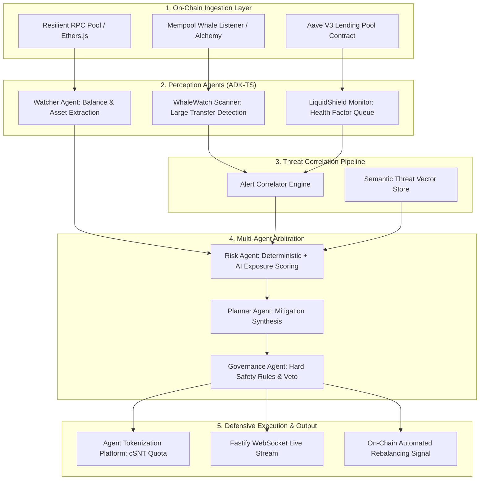

# Chain Sentinel — System Architecture Specification

## 1. Executive Summary

**Chain Sentinel** is a real-time, on-chain intelligence and autonomous defensive layer for decentralized finance (DeFi) treasuries and institutional wallets. 

While conventional DeFi security tools act **reactively** (generating alert notifications hours or days after an exploit or liquidation has occurred), Chain Sentinel is engineered **pre-emptively**: it continuously monitors lending health factors, intercepts mempool whale transactions, correlates compound threats across protocols, and autonomously arbitrates rebalancing actions before insolvency manifests.

Chain Sentinel was architected by **WWHS?** for **ELECTROTHON 8.0** ([Devfolio Submission](https://devfolio.co/projects/chain-sentinel-f7cf)).

---

## 2. Multi-Agent System Architecture (ADK-TS)

Chain Sentinel is constructed on top of **ADK-TS (`@iqai/adk`)**, the TypeScript Agent Development Kit. Agents operate as specialized autonomous entities coordinated through explicit state workflows and deterministic failsafes.

---

## 3. Specialized Agent Roles

### A. Watcher Agent (`watcherAgent.ts`)
- **Responsibility**: Inspects specified EVM treasury addresses across Ethereum and Layer 2 rollups.
- **Tools**: `ethers.JsonRpcProvider`, ERC-20 contract balance readers, multi-token price oracles.
- **Output**: Standardized `TreasurySnapshot` containing total USD asset valuation and individual token positions.

### B. WhaleWatch Scanner Agent (`scannerAgent.ts`)
- **Responsibility**: Subscribes to real-time pending transactions in the mempool exceeding $500,000 USD.
- **Tools**: Alchemy WebSocket filter, known address classification directory.
- **Output**: `WhaleScanResult` detailing source, destination, token, amount, and intent classification (Accumulation, Distribution, CEX Deposit).

### C. LiquidShield Monitor Agent (`monitorAgent.ts`)
- **Responsibility**: Continuously dequeues at-risk lending accounts using a prioritized risk-tier queue.
- **Tools**: Aave V3 `getUserAccountData` on-chain reader, historical health factor logger.
- **Output**: `PositionSnapshot` recording real-time Health Factor, total collateral USD, total borrow debt USD, and liquidation threshold.

### D. Threat Correlator Engine (`alertCorrelator.ts`)
- **Responsibility**: Discovers hidden compound systemic risks. If a monitored treasury exhibits low lending health factors while a connected whale dumps collateral into the mempool, the Correlator synthesizes a `CompoundAlert` with escalated urgency (`CRITICAL`).

### E. Risk Scoring Agent (`riskAgent.ts`)
- **Responsibility**: Computes composite threat score (0 to 100) and assigns risk tiers (`SAFE`, `WARNING`, `DANGER`, `CRITICAL`).
- **Safety Guarantee**: Employs deterministic mathematical scoring first; uses AI LLM analysis strictly for context enrichment.

### F. Protection Planner Agent (`plannerAgent.ts`)
- **Responsibility**: Synthesizes mitigation steps chosen from three constrained primitives:
  - `ALERT`: Notify operators and multisig signers.
  - `REDUCE`: Partially pay down risky lending debt.
  - `DIVERSIFY`: Reallocate concentrated volatile tokens into yield-bearing stablecoins.

### G. Governance Enforcement Agent (`governanceAgent.ts`)
- **Responsibility**: Acts as the ultimate safety arbiter.
- **Hard Safety Rule**: Hardcoded constraints that cannot be bypassed by LLM output. If risk is high and treasury exposure exceeds $1,000,000, emergency actions are automatically enforced regardless of model suggestions.

---

## 4. Agent Tokenization Platform (ATP) Integration

Chain Sentinel is registered with the **Agent Tokenization Platform (ATP)** under the symbol **`cSNT`**.

1. **Agent Identity Verification**: Cryptographically binds the multi-agent system code hash and ADK-TS configuration to an on-chain identity.
2. **Defensive Quota Tokens**: Users and DAOs hold tokenized protection quotas that incentivize continuous surveillance and cover autonomous rebalancing transaction fees.
3. **Transparent Execution**: Every risk assessment and governance decision is recorded with verifiable timestamps and deterministic state proofs.

---

## 5. Resilient Networking & Infrastructure

- **Fastify & WebSockets (`apps/api`)**: Asynchronous, non-blocking REST API and low-latency WebSocket broadcaster with replay buffers.
- **Failover JSON-RPC Pool (`rpcTools.ts`)**: Rotates across primary and secondary RPC providers with exponential backoff to ensure 99.99% on-chain liveness.
- **Semantic Vector Store (`vectorStore.ts`)**: In-memory cosine-similarity index comparing detected anomalies against historical DeFi exploit signatures.
